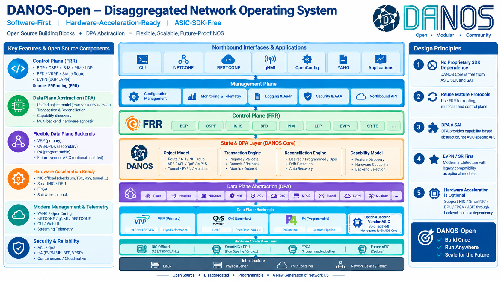

# DANOS ISO Build

This repository provides the live-build recipe for a DANOS 2608 / Debian 13 amd64 ISO. 
The official flow is to build Debian packages from source, publish an APT repository, and generate an ISO with live-build. 
The current pipeline uses OBS for package builds and can publish immutable repository snapshots through Cloudflare R2.

## Hardware support scope

**Hardware-vendor support is out of scope. What this project delivers, and the only thing it commits to, is the
software data plane** (`vyatta-dataplane` on DPDK, running on virtio and standard NIC drivers). Nothing below is a
promise to support, test or maintain any switch ASIC, board support package or vendor SDK.

The source tree still contains hardware-vendor code. It is kept **for reference**. Measured on the 2026-10-30 image
`i-danos_2608_20261030T0752-amd64.hybrid` (sha256 `5d9e25d937fc6dccb8df93bdbdb6a2bc1aa8dd8239491e77d2152f0c0c386fb4`,
1524 packages), on 2026-11-02:

### In the tree, not in the image: present for reference / not built into the image / not verified / not supported

| directory (repo `i-danos/<name>`) | what it is | in the image | built by OBS | installed by a package list |
|---|---|---|---|---|
| `libfal-opennsl` | Broadcom forwarding-abstraction-layer integration on OpenNSL (FAL backend for a switch ASIC) | no | no | no |
| `opennsl-binary` | stub (`dummy` package) standing in for the OpenNSL vendor binary | no | no | no |
| `bcm-kbp-linux-modules`, `bcm-linux-bde-modules` | Broadcom kernel modules (KBP, BDE) | no | no | no |
| `ufispace-apollo-linux-modules`, `ufispace-bsp-utils` | UfiSpace Apollo board support package (kernel modules, Python BSP, LED control) | no | yes (built, never installed) | no |
| `accton-hwdiag` | Accton AS5916-54XKS diagnostics and LED/SFP helpers | no | no | no |

Each directory has a `NOT-IN-BUILD.md` with its own measurements and commands.

### In the image and hardware-specific: **IN IMAGE, not verified, not supported**

These are installed in the image today. They are pulled in as YANG models or as dependencies of generic packages.
They are not removed here, and nothing in this project has exercised them on the hardware they describe.

| package (source package) | why it is installed |
|---|---|
| `vyatta-interfaces-dataplane-deviation-ufi-apollo-ncp1-1-v1-yang` (`vplane-config`) | named in `config/package-lists/vyatta-yang-common.list.chroot`; installs `/opt/vyatta/sbin/breakout-ufi-apollo-ncp1-1` and the Apollo platform file |
| `vyatta-interfaces-bonding-deviation-broadcom-stratadnx-v1-yang` (`vyatta-interfaces-bonding`) | dependency of `vyatta-interfaces-bonding-v1-yang` |
| `vyatta-interfaces-tunnel-deviations-broadcom-dpp-v1-yang` (`vyatta-interfaces`), `vyatta-service-portmonitor-deviation-broadcom-stratadnx-v1-yang` (`vyatta-service-portmonitor`) | Broadcom deviation models for the interface and port-monitor YANG |
| `vyatta-poe`, `vyatta-poe-v1-yang`, `vyatta-interfaces-dataplane-poe-v1-yang` (`vyatta-poe`) | PoE integration; the two YANG packages are in `vyatta-poe.list.chroot`, the daemon package is their dependency |
| `vyatta-platform-util`, `python3-vyatta-platform-detect` (`vyatta-platform`) | dependencies of `vyatta-dataplane`, `vyatta-system` and others. `config/package-lists/danos-additions.list.chroot` says `vyatta-platform-util` is "not needed on the software-only line"; it is installed anyway |
| `vyatta-system-platform-v1-yang`, `vyatta-op-show-platform-v1-yang`, `vyatta-op-show-platform-dataplane-v1-yang`, `vyatta-hardware-binding-v1-yang` | generic platform and FAL-state models; with no offload backend loaded they report the software data plane |
| `librte-crypto-bcmfs25`, `librte-bus-platform25` | Debian's DPDK poll-mode drivers, installed through `librte-meta-allpmds`; supplied by Debian, not by this project |

No out-of-tree vendor kernel module is in the image (`/lib/modules/*/extra` and `/lib/modules/*/updates` do not exist).

### If hardware support were ever wanted

There is no plan and no commitment. It would need, at least: the physical target (a specific switch or board, with serial
console and remote power control); a vendor SDK or driver that builds against the current kernel and whose licence allows
redistribution (to be confirmed with the vendor); a test suite run on that hardware with evidence bound to the image; and a
named party committing to maintain it. Until then the items above stay "for reference".

### How to recompute these tables

From the workstation checkout root (`/home/aikon/danos`), with `NAMES` set to the binary package names you want to check:

```
# in the image? (an empty list means no)
python3 -c "import json,sys;n=set(sys.argv[1:]);S=json.load(open('releases/i-danos_2608_20261030T0752-amd64.hybrid/sbom.json'))['packages'];print(sorted(p['name'] for p in S if p['name'] in n))" $NAMES
# installed by a package list? (no output means no)
for n in $NAMES; do grep -nE "^[[:space:]]*$n[[:space:]]*(#.*)?\$" build-iso/danos-sources/build-iso/config/package-lists/*.chroot; done
# built by OBS? (1 means yes)
for n in $NAMES; do echo $n $(grep -cE "^Package: $n\$" build-iso/danos-build/repo-index/Packages); done
# what depends on an installed package inside the image (extract the squashfs first)
xorriso -osirrox on -indev <iso> -extract /live/filesystem.squashfs /tmp/fs.sq && unsquashfs -cat /tmp/fs.sq var/lib/dpkg/status | grep -B12 "^Depends:.*\\bvyatta-platform-util\\b" | grep '^Package:'
```

## Public test builds

Pre-built test images are published on the
[Releases page](https://github.com/i-danos/build-iso/releases) as pre-releases.
**They are test builds, not for production.** How to verify, install and
Secure-Boot-enroll an image, what was tested and the known limitations are in
[docs/PUBLIC-TEST.md](docs/PUBLIC-TEST.md). Security reports:
[SECURITY.md](SECURITY.md). Licenses and where to get the source:
[LICENSING.md](LICENSING.md).

A GitHub Actions workflow (`.github/workflows/build-iso.yml`) builds the product
and test images weekly from the newest accepted R2 package snapshot, boots the
product image under QEMU/KVM, and checks `show version`. It needs no secrets.
The same workflow runs the Robot regression (99 cases: BGP, IPsec, MPLS-LDP,
firewall, REST, data-plane objects, BGP EVPN, multicast) on the test image weekly
or when started with `regression=true`, uploads the results as the `robot-results`
artifact, and opens an issue when a scheduled run fails. Start a build by hand with
`gh workflow run build-iso.yml -R i-danos/build-iso -f regression=true`
(add `-f publish=true` to publish the accepted image as a pre-release).

## DANOS Architecture



## Local Container Build

Docker is required. 
The container runs in privileged mode because live-build needs chroot, mount, loop, and squashfs operations:

```bash
./scripts/build-iso-container.sh
```

Default APT source:

```text
https://r2.aikon.qzz.io/danos-apt/test/
```

Override it when required:

```bash
DANOS_APT_URL=https://apt.example/2608/snapshot/ \
SOURCE_DATE_EPOCH=1758956640 \
./scripts/build-iso-container.sh
```

Artifacts are written to `container-output/`, including the ISO, SHA256 file, build log, and live-build metadata. 
The container copies only source and configuration files, excluding stale host-side `.build/`, `binary/`, `cache/`, and `chroot/` directories.

See the following documents for design details:

- [Container Build](docs/CONTAINER-BUILD.md)
- [OBS to R2 APT Repository](docs/R2-APT.md)
- [GitHub CI/CD Plan](docs/CI-CD-PLAN.md)
- [Comparison with jsouthworth](docs/COMPARISON.md)
